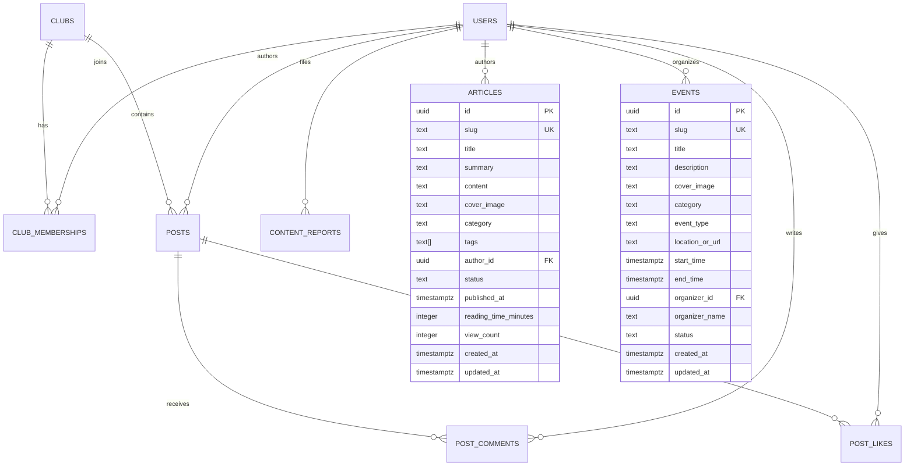

# Vetopia Mobile — Milestone 4 (M4) Implementation Plan: Animal Clubs, Social Feed, Blogs & Events

> **Status:** PROPOSED IMPLEMENTATION PLAN (PHASE 0 AUDIT & PLANNING COMPLETE)  
> **Document Reference:** `DOC-ROADMAP-M4-001`  
> **Target Milestone:** M4 (Pet Clubs, Social Community, Blogs & Events)  
> **Target Environment:** Expo SDK 57 · React Native 0.86 · React 19.x · TypeScript 6.0 · Supabase PostgreSQL RLS  
> **Author:** Antigravity AI Engineering Team  
> **Date:** October 2026  

---

## 1. Executive Summary

Milestone 4 (M4) of the Vetopia mobile application introduces community engagement, knowledge sharing, and peer-to-peer discovery across six dedicated animal categories (Cats, Dogs, Birds, Horses, Farm Animals, and Poultry), backed by a unified social feed, educational blog articles, and community event listings.

### Audit Summary
A comprehensive audit of the active repository reveals that **Milestone 4 is already partially implemented**:
1. **Database Schema & RLS:** Migration `supabase/migrations/20261012210000_pet_clubs_schema.sql` (900 lines) already establishes tables for `public.clubs`, `public.club_memberships`, `public.posts`, `public.post_comments`, `public.post_likes`, `public.post_media`, and `public.content_reports`. It also includes automated counter-synchronization triggers, RLS policies, seed data for all six clubs, and high-performance RPCs (`join_club`, `leave_club`, `toggle_post_like`, `get_club_feed`, `moderate_content`).
2. **Client Services & UI Components:** `src/lib/clubs/clubService.ts`, `src/lib/clubs/clubPhotoService.ts`, `src/hooks/useClubs.ts`, and components in `src/components/clubs/` (`ClubCard.tsx`, `PostCard.tsx`, `CommentItem.tsx`, `ReportModal.tsx`) are already operational.
3. **Existing Screens:** `app/clubs/index.tsx`, `app/clubs/[id].tsx`, `app/clubs/[id]/create-post.tsx`, and `app/clubs/post/[id].tsx` provide functional club browsing, club feeds, post creation with images, comments, likes, and content reporting.

### Identified Gaps
1. **Global Community Feed:** Currently, `get_club_feed` and `ClubDetailsScreen` require a `club_id`. There is no dedicated global community feed querying posts where `club_id IS NULL` (general community posts) or aggregating approved public posts across clubs and general community.
2. **Educational Blogs / Articles:** Missing entirely. No database table (`articles`), domain types, service, React Query hooks, browsing screens, or authoring tools exist.
3. **Community Events:** Missing entirely. No database table (`events`), domain types, service, React Query hooks, browsing screens, or management tools exist.
4. **Publishing Authorization:** Need explicit server-side authorization defining who can create educational blog articles and community events (e.g., verified veterinarians and administrators).
5. **Top-Level Navigation Entry:** Clubs are currently accessed via a quick link in Care Hub (`app/(tabs)/care.tsx`). A unified Community navigation structure (accommodating Clubs, Global Feed, Blogs, and Events) is required.

---

## 2. Confirmed M4 Scope and Exclusions

### 2.1 In-Scope Features
* **Module 1: Animal Clubs (FR-COM-001)**
  * Six dedicated clubs seeded and active: Dogs, Cats, Birds, Horses, Farm Animals, and Poultry.
  * Club discovery directory with real-time text search and category filtering.
  * Idempotent membership join and leave actions via database RPCs.
  * Dynamic member count and post count synchronization maintained by PostgreSQL triggers.
  * Club detail view featuring banner, description, member counter, and club-specific feed.
* **Module 2: Social Feeds & Media Posts (FR-COM-002, FR-COM-003)**
  * **Global Community Feed:** Unified feed displaying public community posts (`club_id IS NULL`) or general community discussions with cursor-based pagination.
  * **Club-Specific Feeds:** Dedicated chronological feed within each of the six animal clubs.
  * **Post Authoring:** Authenticated text posts (1 to 5,000 characters) with optional single-image attachment.
  * **Media Upload:** Native image selection via `expo-image-picker` with client-side format/size validation (JPEG, PNG, WebP ≤ 10MB) uploaded to Supabase Storage `user-media` bucket under `{userId}/posts/`.
  * **Content Ownership & Editing:** Authors can edit post text or replace images; authors can delete their own posts.
  * **Reactions & Engagement:** Atomic like/unlike toggle enforced by composite primary key `(post_id, user_id)` on `public.post_likes`. Club membership is required to like posts in club-specific feeds.
  * **Discussion & Comments:** Comment threads on posts with author avatar, verified vet badge, relative timestamp, and self-service edit/delete.
* **Module 3: Content Moderation & Reporting (FR-COM-005, FR-COM-006)**
  * User-facing reporting modal for posts and comments with structured reasons: `spam`, `harassment`, `inappropriate`, `misinformation`, `other`.
  * Unique constraint preventing duplicate pending reports on the same target by the same reporter.
  * Administrative moderation RPC `public.moderate_content` to `hide`, `remove`, or `restore` flagged content and update associated report statuses.
* **Module 4: Educational Blog Articles (FR-COM-007)**
  * Searchable and filterable directory of educational pet health and care articles.
  * Article details screen with rich text/markdown rendering, estimated reading time, author credential card, and tags.
  * Role-gated publishing workflow: verified veterinarians (`vet` with `vet_profiles.verified = true`) and platform administrators (`admin`) can create, edit, publish, and unpublish articles. Draft articles remain hidden from public users via PostgreSQL RLS.
* **Module 5: Community Events (FR-COM-007)**
  * Directory of upcoming and past community events (webinars, local vaccination drives, adoption fairs, breed meetups).
  * Event details view showing date/time, format (virtual vs. in-person), location/URL, organizer snapshot, and description.
  * Role-gated event management: verified veterinarians and administrators can draft, publish, update, and cancel events.

### 2.2 Explicit Exclusions (Deferred Beyond M4)
In strict accordance with the product scope and PRD/SRS boundary rules, the following capabilities are **explicitly deferred**:
* ❌ **Direct Peer-to-Peer 1-to-1 Community Chat:** Direct messaging remains strictly confined to authorized doctor-parent telemedicine consultation threads (`MVP-07 Clinical Messaging`).
* ❌ **User Following / Follower Graph:** Bidirectional social follow relationships between users.
* ❌ **External Social Media Sharing:** Native OS share sheets and web dynamic link preview generation.
* ❌ **Event Ticketing & Paid Registration:** Event RSVP tracking, ticket generation, attendance caps, and paid admissions (deferred to commercial phases).
* ❌ **Paid Club Memberships / VIP Tiers:** Monetized club subscriptions (deferred to M7 Global Payments & Memberships).
* ❌ **Algorithmic Personalized Feed Ranking:** ML-driven feed ordering; feeds strictly use reverse-chronological cursor pagination.

---

## 3. Repository Audit Findings

### 3.1 Architecture & Directory Structure
```text
s:\unimate\vetopia\mobile\
├── app/
│   ├── (auth)/             # Authentication screens (welcome, login, register, onboarding)
│   ├── (tabs)/             # 5 Bottom tabs (_layout, index, vets, appointments, messages, care)
│   ├── ai/                 # Gemini 3.8 Flash AI triage assistant
│   ├── booking/            # Doctor profile & appointment booking wizard
│   ├── clubs/              # [EXISTING M4] Clubs directory, details, post creation, post details
│   ├── consult/            # Telemedicine waiting room, WebRTC consultation, prescription authoring
│   ├── messages/           # 1-to-1 clinical messaging thread
│   ├── pets/               # Pet management & digital health passport
│   ├── prescriptions/      # Prescription viewer & signed PDF exporter
│   ├── settings/           # Profile, biometrics, security, and notification preferences
│   └── vet/                # Doctor portal dashboard
├── src/
│   ├── components/
│   │   ├── clubs/          # [EXISTING M4] ClubCard, PostCard, CommentItem, ReportModal
│   │   ├── layout/         # Screen, SafeAreaView
│   │   └── ui/             # Atomic primitives: Button, Card, Avatar, Badge, Chip, Input, Heading, Text
│   ├── hooks/
│   │   └── useClubs.ts     # [EXISTING M4] React Query hooks for clubs, posts, comments, likes
│   ├── lib/
│   │   ├── api/            # ApiClient, typed HTTP client, error hierarchy
│   │   ├── auth/           # Supabase Auth, biometrics, SecureStorageAdapter
│   │   ├── clubs/          # [EXISTING M4] clubService.ts, clubPhotoService.ts
│   │   └── supabase/       # Supabase client singleton
│   ├── store/              # Zustand stores (useAuthStore, useUIStore)
│   ├── theme/              # Palette tokens, typography, spacing, radii, shadows
│   └── types/
│       └── club.ts         # [EXISTING M4] Club, ClubPost, ClubComment, ContentReport types
├── supabase/
│   └── migrations/         # 23 versioned SQL migrations
└── tests/
    ├── components/         # 17 component test suites (including ClubScreens.test.tsx)
    └── unit/               # 27 unit test suites (including club-service.test.ts)
```

### 3.2 Active Dependencies & Environment
* **Framework:** Expo SDK 57 (`~57.0.26`), React Native 0.86.3, React 19.2.3.
* **Navigation:** Expo Router 57 (`~57.0.24`) with file-based routing and deep-linking support.
* **State & Data Fetching:** TanStack React Query (`^5.83.0`), Zustand (`^5.0.3`).
* **Backend & Database:** Supabase JS (`^2.105.3`), PostgreSQL 15+ with Row Level Security.
* **Media & Hardware:** `expo-image-picker` (`~57.0.20`), `expo-secure-store` (`~57.0.4`), `expo-local-authentication` (`~57.0.3`).
* **Icons & Styling:** `lucide-react-native` (`^0.575.0`), centralized vanilla design system (`src/theme/`).
* **Testing:** Jest 29 (`^29.7.0`), React Native Testing Library (`^13.3.2`), `jest-expo` (`~57.0.0`).

### 3.3 Database & RLS Inventory
* **Migration `20261012210000_pet_clubs_schema.sql` (Verified Active):**
  * Tables: `public.clubs`, `public.club_memberships`, `public.posts`, `public.post_comments`, `public.post_likes`, `public.post_media`, `public.content_reports`.
  * Trigger Functions: `sync_post_caption_content()`, `sync_club_member_count()`, `sync_club_post_count()`, `sync_post_likes_count()`, `sync_post_comments_count()`.
  * RLS Policies:
    * `clubs`: Public read for active clubs; admin-only insert/update/delete.
    * `club_memberships`: Public read; authenticated user can insert/delete own membership (`user_id = auth.uid()`).
    * `posts`: Select approved posts, or own posts regardless of status, or admin; insert requires `author_id = auth.uid()` and club membership if `club_id IS NOT NULL`; update/delete restricted to author or admin.
    * `post_comments`: Select approved comments or own comments; insert requires authenticated user and club membership if post belongs to a club; update/delete restricted to comment author or admin.
    * `post_likes`: Select public; insert requires user and club membership if post belongs to a club; delete restricted to own like.
    * `content_reports`: Reporter can view own reports; admin can view all; reporter inserts; admin updates/deletes.
  * RPC Functions:
    * `public.join_club(p_club_id UUID)`: Idempotent join.
    * `public.leave_club(p_club_id UUID)`: Safe leave.
    * `public.toggle_post_like(p_post_id UUID)`: Atomic like/unlike toggle.
    * `public.get_club_feed(p_club_id UUID, p_limit INT, p_cursor TIMESTAMPTZ)`: Cursor-paginated club feed with hydrated author profiles, verified vet badges, and caller like state.
    * `public.moderate_content(p_target_type TEXT, p_target_id UUID, p_action TEXT, p_notes TEXT)`: Admin-only moderation action.
  * Seed Data: Six clubs seeded with Unsplash covers and Lucide icons: Dogs (`dogs`), Cats (`cats`), Birds (`birds`), Horses (`horses`), Farm Animals (`farm-animals`), Poultry (`poultry`).

### 3.4 Missing Entities & Capabilities
* **Articles / Blogs:** No table `public.articles` exists. No service or screens exist.
* **Events:** No table `public.events` exists. No service or screens exist.
* **Global Feed:** No RPC exists to fetch global posts (`club_id IS NULL`) or aggregated community feed. `clubService.createPost` currently enforces `club_id` as non-null in TypeScript and requires club membership.
* **Navigation:** `app/(tabs)/care.tsx` is the sole entry point to `/clubs`. A unified community entry point is needed.

---

## 4. Existing Reusable Features

| Component / Utility | File Path | Reuse Rationale |
| :--- | :--- | :--- |
| `ClubCard` | `src/components/clubs/ClubCard.tsx` | Reusable card for club listing, showing banner, icon, name, member counter, and join/leave toggle. |
| `PostCard` | `src/components/clubs/PostCard.tsx` | Complete social post card with author avatar, verified vet badge, relative time, post text, image, like button, comment button, overflow menu, and reporting modal. |
| `CommentItem` | `src/components/clubs/CommentItem.tsx` | Complete comment row with inline editing, deletion, report trigger, and author credentials. |
| `ReportModal` | `src/components/clubs/ReportModal.tsx` | Reusable modal dialog for submitting content abuse reports with validation and reason selector. |
| `clubPhotoService` | `src/lib/clubs/clubPhotoService.ts` | Complete image selection (camera/library) and Supabase Storage upload pipeline targeting `user-media` bucket. |
| `clubService` | `src/lib/clubs/clubService.ts` | Production-ready Supabase RPC callers, query builders, error normalization, and fallback mechanisms. |
| `useClubs` | `src/hooks/useClubs.ts` | TanStack Query hooks with optimistic updates and cache invalidation. |
| Theme Primitives | `src/components/ui/` | `Button`, `Card`, `Badge`, `Chip`, `Input`, `Avatar`, `Heading`, `Text`, `Screen` enforce strict design compliance. |

---

## 5. Gap & Requirements Traceability Matrix

| Req ID | User-Visible Behavior | PRD/SRS Ref | Current Status | Dependencies | Acceptance Criteria | Required Tests |
| :--- | :--- | :--- | :--- | :--- | :--- | :--- |
| **FR-COM-001** | Discover, browse, and join/leave 6 animal clubs | PRD §5 / SRS FR-COM-001 | **Existing / Verified** | `clubs`, `club_memberships`, `join_club`, `leave_club` | Users can view all 6 clubs, search by name, join/leave idempotently, and see member counts update live. | `tests/unit/club-service.test.ts`, `tests/components/ClubScreens.test.tsx` |
| **FR-COM-002A** | View club-specific social feed | PRD §5 / SRS FR-COM-002 | **Existing / Verified** | `posts`, `get_club_feed` RPC | Member and non-member users can scroll club discussions with reverse-chronological cursor pagination. | `tests/unit/club-service.test.ts` |
| **FR-COM-002B** | Create, edit, and delete text posts with optional images | PRD §5 / SRS FR-COM-002 | **Existing / Verified** | `posts`, `user-media` storage bucket | Authenticated members can post text (≤5000 chars) + image (≤10MB); authors can edit text/image or delete post. | `tests/unit/club-service.test.ts`, `tests/components/ClubScreens.test.tsx` |
| **FR-COM-002C** | Global Community Feed (posts without club or cross-club) | PRD §5 / SRS FR-COM-002 | **Missing** | New RPC `get_community_feed` or updated `posts` query | Authenticated users can browse and post to a global community feed (`club_id IS NULL`). | Unit test for global feed query, screen test for global feed |
| **FR-COM-003A** | Like and unlike posts atomically | PRD §5 / SRS FR-COM-003 | **Existing / Verified** | `post_likes`, `toggle_post_like` RPC | 1 like per user per post enforced by DB constraint; triggers keep `likes_count` synchronized. | `tests/unit/club-service.test.ts` |
| **FR-COM-003B** | Comment on posts, edit/delete own comments | PRD §5 / SRS FR-COM-003 | **Existing / Verified** | `post_comments`, RLS policies | Comments display chronologically with author details; authors can edit or delete own comments. | `tests/unit/club-service.test.ts` |
| **FR-COM-005** | Report abusive posts and comments | PRD §5 / SRS FR-COM-005 | **Existing / Verified** | `content_reports`, `ReportModal` | Users can submit report with reason; duplicate reports prevented; stored in `content_reports`. | `tests/unit/club-service.test.ts` |
| **FR-COM-006** | Administrator content moderation | PRD §5 / SRS FR-COM-006 | **Existing / Verified** | `moderate_content` RPC | Admins can hide, remove, or restore flagged posts/comments; updates report audit fields. | `tests/unit/club-service.test.ts` |
| **FR-COM-007A** | Browse educational blog articles | PRD §5 / SRS FR-COM-007 | **Missing** | New table `public.articles` | Users can browse articles by category/tag, view full article text, reading time, and author vet credentials. | Unit test for articleService, component test for ArticleScreens |
| **FR-COM-007B** | Authorized authoring of blog articles | PRD §5 / SRS FR-COM-007 | **Missing** | New table `public.articles`, RLS | Verified veterinarians and admins can create, edit, publish, and archive educational articles. Drafts hidden. | Security unit test validating non-vet/non-admin cannot publish |
| **FR-COM-007C** | Browse community events | PRD §5 / SRS FR-COM-007 | **Missing** | New table `public.events` | Users can browse upcoming/past events by category and format (virtual/in-person) with dates and links. | Unit test for eventService, component test for EventScreens |
| **FR-COM-007D** | Authorized authoring of community events | PRD §5 / SRS FR-COM-007 | **Missing** | New table `public.events`, RLS | Verified veterinarians and admins can create, update, and cancel events. Drafts protected. | Security unit test validating authorization |

---

## 6. Proposed Target Architecture & Data Model

### 6.1 Database Schema Additions (`supabase/migrations/20261025120000_m4_community_blogs_events.sql`)



#### Table: `public.articles`
* **Purpose:** Stores educational pet care and clinical veterinary articles.
* **Fields:**
  * `id UUID PRIMARY KEY DEFAULT gen_random_uuid()`
  * `slug TEXT NOT NULL UNIQUE` (URL-safe identifier)
  * `title TEXT NOT NULL CHECK (char_length(title) BETWEEN 3 AND 200)`
  * `summary TEXT NOT NULL CHECK (char_length(summary) BETWEEN 10 AND 500)`
  * `content TEXT NOT NULL CHECK (char_length(content) >= 50)`
  * `cover_image TEXT` (Supabase Storage URL or approved CDN)
  * `category TEXT NOT NULL` (e.g., 'Canine Health', 'Feline Nutrition', 'Avian Care', 'Equine Wellness', 'Livestock', 'Preventative')
  * `tags TEXT[] NOT NULL DEFAULT '{}'`
  * `author_id UUID NOT NULL REFERENCES public.profiles(id) ON DELETE CASCADE`
  * `status TEXT NOT NULL DEFAULT 'draft' CHECK (status IN ('draft', 'published', 'archived'))`
  * `published_at TIMESTAMPTZ`
  * `reading_time_minutes INTEGER NOT NULL DEFAULT 3`
  * `view_count INTEGER NOT NULL DEFAULT 0`
  * `created_at TIMESTAMPTZ NOT NULL DEFAULT NOW()`
  * `updated_at TIMESTAMPTZ NOT NULL DEFAULT NOW()`
* **Indexes:**
  * `idx_articles_status_published` ON `articles(status, published_at DESC)` WHERE `status = 'published'`
  * `idx_articles_category` ON `articles(category)`
  * `idx_articles_author` ON `articles(author_id)`
* **RLS Policies:**
  * `SELECT`: Permitted for all users (anon & authenticated) if `status = 'published'`; permitted for `author_id = auth.uid()` or users with role `admin` regardless of status.
  * `INSERT`: Restricted to authenticated users who either hold role `admin` OR hold role `vet` with verified status (`EXISTS (SELECT 1 FROM public.vet_profiles WHERE user_id = auth.uid() AND verified = TRUE)`).
  * `UPDATE / DELETE`: Restricted to the article `author_id = auth.uid()` (if author has publishing rights) or users with role `admin`.

#### Table: `public.events`
* **Purpose:** Stores community webinars, vaccination drives, adoption fairs, and pet meetups.
* **Fields:**
  * `id UUID PRIMARY KEY DEFAULT gen_random_uuid()`
  * `slug TEXT NOT NULL UNIQUE`
  * `title TEXT NOT NULL CHECK (char_length(title) BETWEEN 3 AND 150)`
  * `description TEXT NOT NULL CHECK (char_length(description) >= 20)`
  * `cover_image TEXT`
  * `category TEXT NOT NULL` (e.g., 'Webinar', 'Vaccination Clinic', 'Adoption Fair', 'Breed Meetup', 'Training Workshop')
  * `event_type TEXT NOT NULL DEFAULT 'virtual' CHECK (event_type IN ('virtual', 'in_person'))`
  * `location_or_url TEXT NOT NULL`
  * `start_time TIMESTAMPTZ NOT NULL`
  * `end_time TIMESTAMPTZ NOT NULL CHECK (end_time > start_time)`
  * `organizer_id UUID NOT NULL REFERENCES public.profiles(id) ON DELETE CASCADE`
  * `organizer_name TEXT NOT NULL`
  * `status TEXT NOT NULL DEFAULT 'draft' CHECK (status IN ('draft', 'published', 'cancelled', 'completed'))`
  * `created_at TIMESTAMPTZ NOT NULL DEFAULT NOW()`
  * `updated_at TIMESTAMPTZ NOT NULL DEFAULT NOW()`
* **Indexes:**
  * `idx_events_status_time` ON `events(status, start_time ASC)` WHERE `status = 'published'`
  * `idx_events_category` ON `events(category)`
  * `idx_events_organizer` ON `events(organizer_id)`
* **RLS Policies:**
  * `SELECT`: Permitted for all users if `status IN ('published', 'completed')`; permitted for `organizer_id = auth.uid()` or role `admin` regardless of status.
  * `INSERT`: Restricted to authenticated users who hold role `admin` OR verified role `vet`.
  * `UPDATE / DELETE`: Restricted to `organizer_id = auth.uid()` or role `admin`.

#### High-Performance RPC: `public.get_community_feed`
* **Purpose:** Serves the global community feed with reverse-chronological cursor pagination and author profile hydration.
```sql
CREATE OR REPLACE FUNCTION public.get_community_feed(
  p_club_id UUID DEFAULT NULL,
  p_limit INTEGER DEFAULT 20,
  p_cursor TIMESTAMPTZ DEFAULT NULL
)
RETURNS JSONB
LANGUAGE plpgsql
SECURITY DEFINER
SET search_path = public
AS $$
DECLARE
  v_user_id UUID;
  v_results JSONB;
BEGIN
  v_user_id := auth.uid();

  SELECT jsonb_agg(
    jsonb_build_object(
      'id', p.id,
      'club_id', p.club_id,
      'author_id', p.author_id,
      'content', COALESCE(p.content, p.caption),
      'caption', COALESCE(p.caption, p.content),
      'image_url', p.image_url,
      'status', p.status,
      'likes_count', p.likes_count,
      'comments_count', p.comments_count,
      'created_at', p.created_at,
      'updated_at', p.updated_at,
      'author', jsonb_build_object(
        'id', prof.id,
        'full_name', prof.full_name,
        'avatar_url', prof.avatar_url
      ),
      'club', CASE 
        WHEN c.id IS NOT NULL THEN jsonb_build_object('id', c.id, 'name', c.name, 'slug', c.slug)
        ELSE NULL
      END,
      'is_vet_verified', COALESCE(vp.verified, false),
      'user_has_liked', CASE 
        WHEN v_user_id IS NULL THEN false
        ELSE EXISTS (
          SELECT 1 FROM public.post_likes pl 
          WHERE pl.post_id = p.id AND pl.user_id = v_user_id
        )
      END
    )
    ORDER BY p.created_at DESC
  ) INTO v_results
  FROM (
    SELECT *
    FROM public.posts
    WHERE (p_club_id IS NULL OR club_id = p_club_id)
      AND status = 'approved'
      AND (p_cursor IS NULL OR created_at < p_cursor)
    ORDER BY created_at DESC
    LIMIT LEAST(p_limit, 50)
  ) p
  LEFT JOIN public.profiles prof ON prof.id = p.author_id
  LEFT JOIN public.vet_profiles vp ON vp.user_id = p.author_id
  LEFT JOIN public.clubs c ON c.id = p.club_id;

  RETURN COALESCE(v_results, '[]'::jsonb);
END;
$$;
```

---

## 7. Authorization & Storage Strategy

### 7.1 Role-Based Access Control (RBAC) Mapping
The database uses the `public.app_role` enum (`pet_parent`, `vet`, `admin`) backed by table `public.user_roles` and helper function `public.has_role(user_id, role)`.

| Resource | Operation | `guest` | `pet_parent` | `vet` (Unverified) | `vet` (Verified) | `admin` |
| :--- | :--- | :--- | :--- | :--- | :--- | :--- |
| **Clubs** | Read | ✅ Active | ✅ Active | ✅ Active | ✅ Active | ✅ All |
| **Club Memberships** | Join / Leave | ❌ | ✅ Self | ✅ Self | ✅ Self | ✅ Any |
| **Club Posts** | Create / Update / Delete | ❌ | ✅ Member / Own | ✅ Member / Own | ✅ Member / Own | ✅ Any |
| **Global Posts** | Create / Update / Delete | ❌ | ✅ Own | ✅ Own | ✅ Own | ✅ Any |
| **Likes & Comments** | Like / Comment | ❌ | ✅ Member / Auth | ✅ Member / Auth | ✅ Member / Auth | ✅ Any |
| **Reports** | Submit report | ❌ | ✅ Self | ✅ Self | ✅ Self | ✅ Self |
| **Moderation** | Hide / Remove / Restore | ❌ | ❌ | ❌ | ❌ | ✅ All |
| **Articles** | Read Published | ✅ | ✅ | ✅ | ✅ | ✅ |
| **Articles** | Read Drafts | ❌ | ❌ | ❌ | ✅ Own only | ✅ All |
| **Articles** | Create / Edit / Publish | ❌ | ❌ | ❌ | ✅ | ✅ |
| **Events** | Read Published | ✅ | ✅ | ✅ | ✅ | ✅ |
| **Events** | Create / Edit / Cancel | ❌ | ❌ | ❌ | ✅ | ✅ |

### 7.2 Storage Strategy
Supabase Storage bucket `user-media` is already configured with public read access. The upload folder structure enforces row-level ownership:
* **Posts:** `{userId}/posts/{timestamp}-{random}.jpg`
* **Articles:** `{userId}/articles/{timestamp}-{random}.jpg`
* **Events:** `{userId}/events/{timestamp}-{random}.jpg`
* **Client Enforcements:**
  * Maximum size: 10MB per image.
  * MIME types: `image/jpeg`, `image/png`, `image/webp`.
  * Upload helper: Extend `src/lib/clubs/clubPhotoService.ts` to support article and event cover image uploads.

---

## 8. Screen and Navigation Plan

### 8.1 Navigation Architecture
To maintain the verified 5-tab foundation (`Home`, `Find Vet`, `Appointments`, `Messages`, `Care Hub`), the Community Hub is accessible via:
1. **Care Hub Primary Destination:** Elevated "Pet Community & Clubs" card on `app/(tabs)/care.tsx`.
2. **Home Screen Action Pill:** "Community" quick badge in `app/(tabs)/index.tsx`.
3. **Unified Community Hub Screen (`app/community/index.tsx`):**
   * Top segmented control with 4 tabs:
     * **Clubs:** 6 animal clubs with category pills and search.
     * **Feed:** Global social feed with create post CTA.
     * **Articles:** Educational blogs directory with category filters.
     * **Events:** Upcoming webinars and clinics with date badges.

### 8.2 Screen Inventory
| Route | Screen Name | Role / Guard | Description |
| :--- | :--- | :--- | :--- |
| `app/community/index.tsx` | CommunityHubScreen | Public / Auth | Central community hub with segmented tabs (Clubs, Feed, Articles, Events). |
| `app/clubs/index.tsx` | ClubsDirectoryScreen | Public / Auth | Existing 6-club directory with search and join/leave toggles. |
| `app/clubs/[id].tsx` | ClubDetailsScreen | Public / Auth | Existing club hero card, member count, and club-specific feed. |
| `app/clubs/[id]/create-post.tsx` | CreateEditPostScreen | Authenticated Member | Existing post creator with image picker and 5000-char validation. |
| `app/clubs/post/[id].tsx` | PostDetailsScreen | Public / Auth | Existing single post view, comment list, comment input, and report modal. |
| `app/articles/index.tsx` | ArticlesDirectoryScreen | Public / Auth | Searchable grid/list of published articles with category chips. |
| `app/articles/[id].tsx` | ArticleDetailScreen | Public / Auth | Full article reader with author credentials, markdown body, reading time. |
| `app/articles/create.tsx` | CreateEditArticleScreen | Verified Vet / Admin | Article authoring tool with cover upload, category selection, and draft/publish toggle. |
| `app/events/index.tsx` | EventsDirectoryScreen | Public / Auth | Chronological list of upcoming webinars and clinics with virtual/in-person badges. |
| `app/events/[id].tsx` | EventDetailScreen | Public / Auth | Event details with start/end time, location/link, organizer card, and external link launcher. |
| `app/events/create.tsx` | CreateEditEventScreen | Verified Vet / Admin | Event authoring tool with date pickers, link inputs, and category selection. |

---

## 9. Phased Implementation Checklist

### Phase 0: Audit & Planning (Current Task)
* [x] Audit existing database migrations and RLS policies (`20261012210000_pet_clubs_schema.sql`).
* [x] Audit existing client services, hooks, and UI components (`src/lib/clubs/`, `src/components/clubs/`).
* [x] Run baseline verification checks: typecheck, lint, and full test suite (511 passing).
* [x] Design schema additions for `articles`, `events`, and `get_community_feed` RPC.
* [x] Document complete implementation plan at `docs/12-roadmap/m4-implementation-plan.md`.

---

### Phase 1: Database Schema, Migrations, RLS, Storage & Global Feed Foundation
* **Objective:** Establish the persistent database entities, RLS policies, indexes, and RPCs for articles, events, and the global feed.
* **Exact Files to Create:**
  * `supabase/migrations/20261025120000_m4_community_blogs_events.sql`
  * `src/types/article.ts` (Article, CreateArticleDTO, UpdateArticleDTO, ArticleCategory)
  * `src/types/event.ts` (CommunityEvent, CreateEventDTO, UpdateEventDTO, EventCategory, EventType)
* **Exact Files to Modify:**
  * `src/types/club.ts` (Make `club_id` optional in `CreatePostInput` to support global posts)
* **Migrations & Dependencies:**
  * Creates `public.articles` and `public.events` tables with check constraints and foreign keys.
  * Creates RLS policies restricting article/event authoring to verified vets and admins.
  * Implements `public.get_community_feed` RPC with cursor pagination.
* **Acceptance Criteria:**
  * Migration applies cleanly via `supabase db push` or mock execution.
  * Unauthenticated users can read published articles and events, but cannot read drafts.
  * Non-vet/non-admin users are rejected by RLS on INSERT/UPDATE into `articles` and `events`.
* **Tests:**
  * `tests/unit/m4-schema-security.test.ts` (RLS security test validating draft isolation and role gates).
* **Definition of Done:** Zero migration errors; security tests verify role boundaries.

---

### Phase 2: Animal Clubs & Membership Refinements
* **Objective:** Complete and harden the animal clubs directory, category filtering, and membership state reactivity.
* **Exact Files to Modify:**
  * `src/lib/clubs/clubService.ts` (Refine error normalization and offline fallbacks)
  * `app/clubs/index.tsx` (Add horizontal category filter chips: All, Canine, Feline, Equine, Avian, Livestock, Poultry)
  * `src/components/clubs/ClubCard.tsx` (Accessibility touch target audit and skeleton states)
* **Acceptance Criteria:**
  * All 6 seeded clubs render correctly with avatars, descriptions, and member counters.
  * Join and leave actions update local cache immediately and reflect accurate server state.
* **Tests:**
  * `tests/unit/club-service.test.ts` (Enhance test coverage for category filtering).
  * `tests/components/ClubScreens.test.tsx` (Validate category filter chip interactions).
* **Definition of Done:** 100% test pass rate on club discovery and membership flows.

---

### Phase 3: Global & Club Social Feeds, Posts, Media, Likes, Comments & Reporting
* **Objective:** Deliver the global community feed, integrate optional club association on post creation, and verify comment/like/report workflows.
* **Exact Files to Create:**
  * `app/community/feed.tsx` (Global community feed screen with create post CTA)
* **Exact Files to Modify:**
  * `src/lib/clubs/clubService.ts` (Add `getCommunityFeed` method calling `get_community_feed` RPC)
  * `src/hooks/useClubs.ts` (Add `useCommunityFeed` hook with cursor pagination)
  * `app/clubs/[id]/create-post.tsx` (Support global post creation when no `clubId` is passed)
  * `src/components/clubs/PostCard.tsx` (Display club name badge when rendered in global feed)
* **Acceptance Criteria:**
  * Global feed loads reverse-chronologically with infinite scroll / cursor pagination.
  * Posts created without a club appear in the global feed; posts created within a club appear in both the club feed and global feed with a club badge.
  * Media upload validates size (≤10MB) and format before uploading to `user-media`.
  * Like/unlike and comments function identically across global and club feeds.
* **Tests:**
  * `tests/unit/club-service.test.ts` (Add unit tests for `getCommunityFeed` and global post creation).
  * `tests/components/GlobalFeedScreen.test.tsx` (Component test for global feed rendering and post creation).
* **Definition of Done:** Zero test failures; image upload verified with mock and storage contracts.

---

### Phase 4: Educational Blogs & Community Events (Browsing & Authorized Publishing)
* **Objective:** Implement client domain services, React Query hooks, and screens for educational articles and community events.
* **Exact Files to Create:**
  * `src/lib/articles/articleService.ts` (CRUD for articles, search, view increment)
  * `src/hooks/useArticles.ts` (React Query hooks: `useArticles`, `useArticle`, `useCreateArticle`, `useUpdateArticle`)
  * `src/lib/events/eventService.ts` (CRUD for events, upcoming/past filtering)
  * `src/hooks/useEvents.ts` (React Query hooks: `useEvents`, `useEvent`, `useCreateEvent`, `useUpdateEvent`)
  * `src/components/articles/ArticleCard.tsx` (Article preview card with thumbnail, category, title, reading time)
  * `src/components/events/EventCard.tsx` (Event preview card with date badge, type badge, location/link)
  * `app/articles/index.tsx` (Articles directory with search and category chips)
  * `app/articles/[id].tsx` (Article details screen with markdown reader and author credentials)
  * `app/articles/create.tsx` (Article creation/editing screen for verified vets and admins)
  * `app/events/index.tsx` (Events directory with upcoming/past toggle)
  * `app/events/[id].tsx` (Event details screen with calendar metadata and link launcher)
  * `app/events/create.tsx` (Event creation/editing screen for verified vets and admins)
* **Exact Files to Modify:**
  * `app/community/index.tsx` (Integrate Articles and Events tabs)
* **Acceptance Criteria:**
  * Users can browse and search published articles and events.
  * Article reader calculates reading time and formats clinical content legibly.
  * Events display clear date/time indicators and open virtual URLs in system browser.
  * Only users with verified `vet` or `admin` role see the "Write Article" and "Create Event" buttons.
* **Tests:**
  * `tests/unit/article-service.test.ts` (Unit tests for article CRUD and validation).
  * `tests/unit/event-service.test.ts` (Unit tests for event scheduling and status transitions).
  * `tests/components/ArticleScreens.test.tsx` (Component tests for article directory and reader).
  * `tests/components/EventScreens.test.tsx` (Component tests for event directory and details).
* **Definition of Done:** Complete test coverage for article and event services and UI states.

---

### Phase 5: Integration, Navigation Polish, Regression & Release Verification
* **Objective:** Wire up top-level navigation, perform end-to-end regression testing across M1–M4, verify accessibility, and validate release bundles.
* **Exact Files to Modify:**
  * `app/(tabs)/care.tsx` (Connect Community Hub entry card)
  * `app/(tabs)/index.tsx` (Add Community quick-access card)
  * `docs/12-roadmap/implementation-roadmap.md` (Update roadmap progress to record M4 completion)
* **Verification Commands:**
  * `npm run typecheck` (Must pass with 0 errors)
  * `npm run lint` (Must pass with 0 errors)
  * `npm test` (All 44+ test suites must pass)
  * `npx expo export --no-bytecode` (Must pass for iOS, Android, and Web)
* **Definition of Done:** All baseline quality gates pass with zero regressions to M1 telemedicine, prescriptions, appointments, or authentication.

---

## 10. Acceptance Criteria and Test Plan

### 10.1 Automated Test Suites Plan

```
tests/
├── unit/
│   ├── club-service.test.ts               # [Existing: 17 tests] Discovery, join/leave, posts, comments, likes, reports, moderation
│   ├── article-service.test.ts            # [New: ~15 tests] Article search, slug generation, reading time, draft vs published, view count
│   ├── event-service.test.ts              # [New: ~15 tests] Event filtering (upcoming vs past), virtual vs in-person, date validation
│   └── m4-authorization-security.test.ts # [New: ~12 tests] RLS security: vet/admin authoring rules, draft isolation, report moderation
└── components/
    ├── ClubScreens.test.tsx               # [Existing: 11 tests] ClubsHome, ClubDetails, PostCard, CommentItem, ReportModal
    ├── GlobalFeedScreen.test.tsx          # [New: ~8 tests] Global feed rendering, empty state, post creation CTA
    ├── ArticleScreens.test.tsx            # [New: ~10 tests] Articles list, search, article reader, author card
    └── EventScreens.test.tsx              # [New: ~8 tests] Events list, upcoming/past toggle, event details, external link launcher
```

### 10.2 Quality Gates
1. **Type Safety:** `tsc --noEmit` exits with code 0 across the entire workspace.
2. **Linting:** ESLint exits with code 0.
3. **Test Suite:** 100% of existing 511 tests + ~68 new M4 tests pass with zero failures.
4. **Security Invariant:** Client never handles `service_role` keys; draft editorial content is protected at the PostgreSQL RLS layer.

---

## 11. Risks, Dependencies and Unresolved Questions

### 11.1 Key Dependencies
1. **Supabase PostgreSQL & RLS:** All authorization must be enforced via database policies.
2. **Supabase Storage `user-media`:** Relies on existing storage bucket for post, article, and event media.
3. **Expo Image Picker:** Native camera and photo library permissions on iOS and Android.

### 11.2 Risks & Mitigations
* **Risk 1: Feed Performance & High Post Volume**  
  * *Mitigation:* The `posts` table uses composite index `(club_id, created_at DESC)` and cursor pagination (`created_at < p_cursor LIMIT 20`), avoiding expensive offset queries.
* **Risk 2: Abusive or Inappropriate Content**  
  * *Mitigation:* Users can flag content via `content_reports`; admins can instantly hide or remove content via `moderate_content` RPC.
* **Risk 3: Accidental Privilege Escalation on Blog/Event Authoring**  
  * *Mitigation:* RLS policies on `articles` and `events` verify either `has_role(auth.uid(), 'admin')` OR verified vet credentials from `public.vet_profiles`. Direct client writes are rejected if these conditions are not met.

### 11.3 Unresolved Product Decisions
1. **Article Author Scope:** Should verified veterinarians be permitted to publish educational articles immediately, or must their articles go through an administrative review (`status = 'pending_review'`) before becoming public?
   * *Recommendation:* For M4, allow verified veterinarians (`vet_profiles.verified = true`) to directly publish educational articles to encourage expert clinical content, with administrative ability to unpublish/hide if needed.
2. **Navigation Placement:** Should Community be added as a 6th bottom tab or housed inside the existing Care Hub (`app/(tabs)/care.tsx`)?
   * *Recommendation:* Retain the 5 bottom tabs (`Home`, `Find Vet`, `Appointments`, `Messages`, `Care Hub`) to maintain mobile screen ergonomics, and feature prominent entry cards to Community Hub from both `Home` and `Care Hub`.

---

## 12. Baseline Verification Results

The baseline verification of the existing codebase was conducted on **October 24, 2026** with the following recorded results:

* **TypeScript Compilation:**
  ```text
  Command: npm run typecheck (tsc --noEmit)
  Result: PASS (Exit code: 0, 0 errors)
  ```
* **ESLint Code Quality:**
  ```text
  Command: npm run lint (eslint .)
  Result: PASS (Exit code: 0, 0 errors, 2 pre-existing warnings in livekitNative.tsx)
  ```
* **Jest Automated Test Suite:**
  ```text
  Command: npm test (jest)
  Result: PASS (Exit code: 0)
  Test Suites: 44 passed, 44 total
  Tests:       511 passed, 511 total
  Snapshots:   0 total
  Time:        27.188 s
  ```

---

## 13. Recommended First Implementation Phase

**Recommended Step: Phase 1 — Database Schema, Migrations, RLS, Storage & Global Feed Foundation**

### Why Phase 1 First?
1. **Zero Client Breaking Changes:** Creating the `articles` and `events` tables and deploying the `get_community_feed` RPC establishes the exact database contracts required by subsequent phases without modifying any existing M1–MVP features.
2. **Unblocks Parallel Work:** Once the database tables and types are landed, frontend screens for Articles, Events, and the Global Feed can be constructed and tested against typed models.
3. **Verifiable Security First:** Testing RLS policies and role gates at the database layer guarantees that draft isolation and editorial publishing permissions are airtight before any UI code is written.
